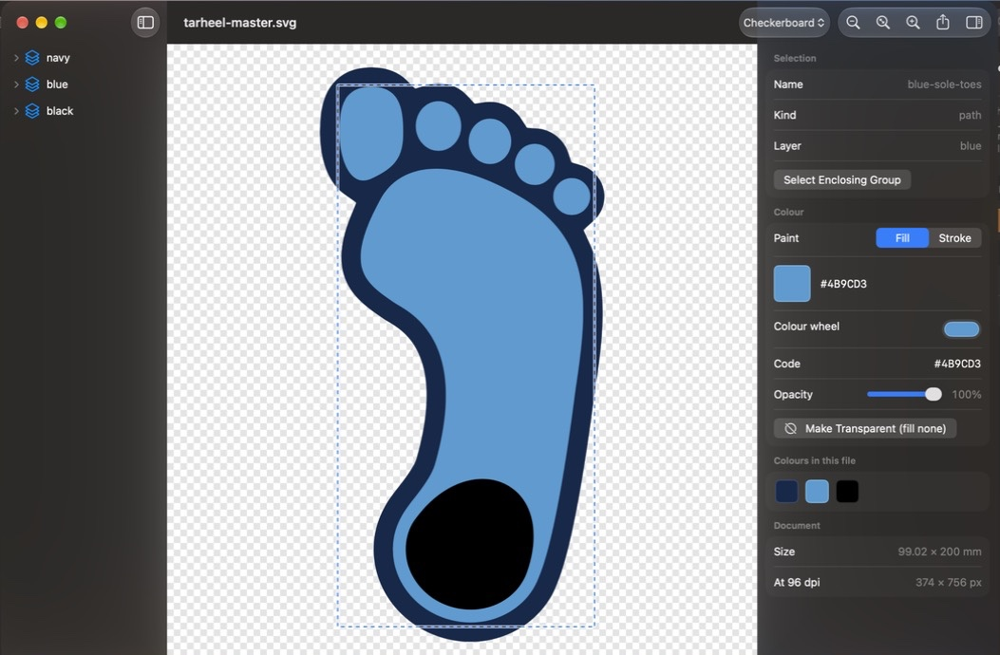

# SVG2Image

A small macOS app for recolouring SVG files and exporting them to raster or PDF.



## Install

Download **`SVG2Image-1.0.dmg`** from [Releases](https://github.com/djb-rh/svg2image/releases), open it and
drag SVG2Image to Applications. It is signed with a Developer ID and notarized by Apple, so it opens
without warnings. Needs macOS 14 or later.

`SVG2Image-1.0.pkg` is also there if you prefer an installer (it puts the same notarized app in
`/Applications`). The package itself isn't signed yet, so macOS stops it the first time: right-click it
and choose **Open**, or click **Open Anyway** in **System Settings ▸ Privacy & Security**.

## Use

- **Open** any `.svg` (File ▸ Open, drag onto the Dock icon, or double-click in Finder once it is the default app).
- **Click** a shape to select it. WebKit's own hit-testing picks the topmost painted shape and honours
  `fill-rule="evenodd"`, so holes in compound paths click through to the layer below.
  - ⌥-click steps down through everything stacked under the pointer.
  - Double-click (or *Select Enclosing Group*) widens the selection to the group/Inkscape layer; a colour
    then applies to every shape inside it.
  - The sidebar lists layers and shapes, so a shape you made transparent can still be reselected.
  - Esc clears the selection.
- **Colour**: the colour wheel (system colour panel), or type a code and press Return:
  `#4B9CD3`, `#4BD`, `#4B9CD380`, `rgb(75 156 211)`, `rgba(75,156,211,.5)`, CSS names, `hsl(…)`, or `none`.
  Fill/Stroke picks which paint to change; the slider sets `fill-opacity`/`stroke-opacity`;
  *Make Transparent* sets the paint to `none`. *Colours in this file* is a one-click palette.
- **Save** with ⌘S. Edits are written as presentation attributes (`fill="#FF8C00"`), so the rest of
  the file — comments, ids, Inkscape layers — is left as it was. Like any Mac document app it autosaves,
  and File ▸ Revert To gets earlier versions back. Undo/redo work.
- **Export** (⇧⌘E): PNG, JPEG, GIF, TIFF, HEIC, BMP, or vector PDF. Type a width or height and the
  other follows the drawing's aspect ratio; quick sizes; a DPI field that is written into the file and,
  for documents in mm/in, an *Actual size* button. Transparent background where the format allows it,
  otherwise (or by choice) a background colour. Largest side 16384 px.

## Default app for SVG

The app declares `public.svg-image` in `Info.plist`. On launch it offers to become the default SVG
handler (with *Don't ask again*), and **SVG2Image ▸ Make SVG2Image the Default App for SVG Files…** does it
any time, via `NSWorkspace.setDefaultApplication(at:toOpen:)`.

## Command line

The same renderer runs without a window:

```bash
"SVG2Image.app/Contents/MacOS/SVG2Image" --export in.svg out.png --width 2000 [--dpi 300] [--background "#FFFFFF"] [--quality 0.9]
```

The format comes from the output extension (`png jpg gif tiff heic bmp pdf`). Use `--height` instead
of `--width` to fix the other side.

## Build

```bash
xcodebuild -project SVG2Image.xcodeproj -scheme SVG2Image -configuration Release -derivedDataPath build build
```

The app lands in `build/Build/Products/Release/SVG2Image.app`, ad-hoc signed. macOS 14 or later.
`scripts/release.sh` does the Release build and writes `dist/SVG2Image-<version>.dmg` and `.pkg`.
Set `SIGN_IDENTITY` (Developer ID Application), `NOTARY_PROFILE` (a `notarytool` keychain profile) and,
for the package, `INSTALLER_IDENTITY` (Developer ID Installer) to sign, notarize and staple them;
without them everything is ad-hoc signed.
No dependencies; rendering is WebKit (display, hit-testing, canvas rasterising, `createPDF`) and
ImageIO (file formats).

## Layout

- `SVG2Image/editor.html`, `editor.js` — the page in the web view: loads the SVG, hit-tests, recolours,
  serializes, rasterizes.
- `EditorModel.swift` — owns the `WKWebView` and the Swift ↔ JS messages.
- `EditorView.swift`, `InspectorView.swift`, `ExportView.swift` — the SwiftUI UI.
- `Exporter.swift` — ImageIO writers and the offscreen PDF renderer.
- `CommandLineExport.swift`, `DefaultHandler.swift`, `CSSColor.swift`, `SVGDocument.swift`.

## License

MIT — see [LICENSE](LICENSE).
